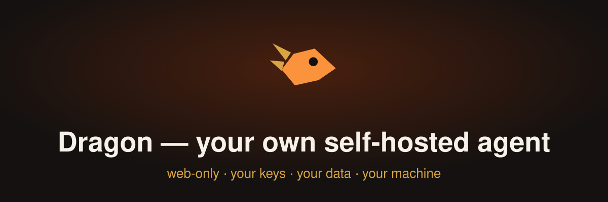

<p align="center">
  
</p>

**Dragon is a self-hosted personal agent that lives on your machine and works in your browser.** One agent — **Ember** — with your model keys, your files and your data, running behind one access token. It does things instead of answering questions: it plans, calls tools, keeps working on your goals, remembers what matters, and stops to ask before anything you could not undo.

There are no accounts, no cloud service and no telemetry. Dragon is a single runtime you run yourself — with Docker or `pip` — and the web app it serves at `http://127.0.0.1:8787`.

- **Bring your own model.** Any OpenAI-compatible endpoint: DeepSeek, OpenAI, OpenRouter, Alibaba Bailian, or a local Ollama / LM Studio / llama.cpp server. Four slots: chat, the screen operator's vision model, image and video.
- **It acts, within limits.** The Sentinel grades every tool call (safe / moderate / sensitive), asks for approval where it should, keeps an audit log, and sandboxes shell commands on Linux.
- **Optional hands.** Browser automation (Playwright) and computer hands (screen, mouse, keyboard) when you want the agent to drive software that has no API.
- **Everything else is yours.** Memory, goals, reminders, triggers, skills, MCP servers, calendar/contacts/email connectors, chat channels (Feishu, DingTalk, WeCom, Telegram), an avatar studio, and coding-agent tasks — all stored in one data directory.

## Quickstart

### Docker (recommended)

```bash
git clone https://github.com/<your-org>/dragon && cd dragon
cp .env.example .env          # put your model key here (e.g. DEEPSEEK_API_KEY=…)
docker compose up -d
docker compose logs -f        # first run prints http://127.0.0.1:8787/#token=… once
```

Open the printed link (or `http://127.0.0.1:8787` and paste the token from `<data_dir>/server_token`). The data directory is the `dragon-data` volume; your files are in `./workspace`.

### From source

Requires Python 3.11+ (Node 22 only if you build the web app yourself).

```bash
pip install -e '.[server,browser]'
cd web && npm ci && npm run build && cd ..   # only when dragon/server/static is not present
dragon serve
```

`dragon serve` prints the access-token URL on first run. It listens on `127.0.0.1:8787` — see [docs/self-hosting.md](docs/self-hosting.md) to reach it from other devices through a reverse proxy with HTTPS.

### First run

1. **Point Ember at a model.** Paste an API key for any provider, or point at a local endpoint (`http://127.0.0.1:11434/v1` for Ollama, `http://127.0.0.1:1234/v1` for LM Studio). [docs/providers.md](docs/providers.md) lists the presets.
2. **Say what you want.** Chat works immediately; goals, reminders and triggers are what keep Ember working while the tab is closed.
3. **Turn on only what you need.** Browser, hands, channels, connectors and MCP servers are off until you enable them.

## What Dragon can do

| | |
|---|---|
| **Chat and tasks** | Multi-step agent runs with tools: files, shell, web search, browser, calendar, contacts, email and more |
| **Goals, reminders, triggers** | Long-term goals it advances on a timer; reminders and routines; mail polls and webhooks that start work |
| **Memory** | Notes it keeps about you and your projects, recalled by keyword or by meaning; the reflector turns what happens into durable lessons, shown on the Memory page |
| **Sentinel approvals** | Sensitive actions become approval cards in the web app; everything is in the audit log |
| **Browser & hands** | Playwright browser automation; screen/mouse/keyboard on the machine the runtime runs on |
| **Channels** | Talk to Ember from Feishu, DingTalk, WeCom or Telegram |
| **MCP & skills** | Any MCP server as tools; skills (Agent Skills format) as reusable how-tos |
| **Connectors** | Email (IMAP/SMTP), calendars (.ics), contacts (.vcf), web search |
| **Avatar studio** | Pictures and clips from your image/video providers, for an agent avatar |
| **Coding agents** | Delegate coding tasks to installed coding CLIs, with the Sentinel watching |

## CLI

`dragon` is kept for setup, admin and backups; day-to-day use happens in the browser.

| Command | What it does |
|---|---|
| `dragon chat` | Talk to Ember in the terminal |
| `dragon run "…"` | Run one task and exit |
| `dragon serve` | Serve the web app (default `127.0.0.1:8787`) |
| `dragon daemon` | Keep advancing goals and triggers on a timer, no UI |
| `dragon goals` | List, add, run and check long-term goals |
| `dragon reminders` | Manage reminders and routines |
| `dragon triggers` | Manage event-driven work (mail polls, webhooks) |
| `dragon memory` | Inspect, edit or export long-term memory |
| `dragon calendar` | Agenda, free time, calendar feeds |
| `dragon contacts` | Search and manage the address book |
| `dragon skills` | List, add and edit skills |
| `dragon vault` | Store credentials the model never sees |
| `dragon config` | `init`, `show` and `path` for the TOML config |
| `dragon audit` | Read the Sentinel's action log |
| `dragon doctor` | Check the installation and the configuration |
| `dragon channels` | Configure chat channels |
| `dragon chatgpt` | Authorize a ChatGPT plan as a model source (optional) |

## Configuration

Settings live in `config/config.toml` (or `~/.dragon/config.toml`); every key is documented in [config/config.example.toml](config/config.example.toml) and [docs/configuration.md](docs/configuration.md). Environment variables (`DRAGON_*`, see [.env.example](.env.example)) override the file. Secrets go in the vault (`dragon vault set NAME`) or the environment — never in the config file.

## Backup and restore

All state is in the data directory (`~/.dragon`, or `/data` in the container):

```bash
# back up
tar czf dragon-backup.tar.gz -C ~ .dragon          # or: docker run --rm -v dragon-data:/data -v "$PWD":/out alpine tar czf /out/dragon-backup.tar.gz -C /data .
# restore
tar xzf dragon-backup.tar.gz -C ~                  # stop Dragon first
```

Back up `./workspace` separately if the agent's files matter. The vault key (`DRAGON_VAULT_KEY` or `<data_dir>/vault.key`) is **not** in config files — keep a copy of it with your backups, or the vault cannot be opened. Details: [docs/self-hosting.md](docs/self-hosting.md).

## Security

- **Bind to `127.0.0.1`** and put a reverse proxy with HTTPS in front of it (Caddy/Traefik examples in [docs/self-hosting.md](docs/self-hosting.md)). Never expose the port raw to the internet.
- **One access token, no accounts.** First run generates it into `<data_dir>/server_token` and prints it once in the `#token=…` link. Rotate it by deleting the file or setting `DRAGON_SERVER_TOKEN`. `--no-auth` is for development only.
- **Your keys stay local** in the vault, and go only to the providers you configure. No telemetry, no update check, no outbound traffic beyond what you set up.
- **The Sentinel** gates tool calls, sandboxes shell commands, and logs everything to the audit trail. See [docs/security.md](docs/security.md).

Report vulnerabilities privately as described in [SECURITY.md](SECURITY.md).

## Documentation

[docs/index.md](docs/index.md) — [quickstart](docs/quickstart.md) · [configuration](docs/configuration.md) · [providers](docs/providers.md) · [self-hosting](docs/self-hosting.md) · [CLI](docs/cli.md) · [security](docs/security.md) · [architecture](docs/architecture.md) · [avatar](docs/avatar.md) · [browser & hands](docs/browser-and-hands.md) · [channels](docs/channels.md) · [MCP](docs/mcp.md) · [skills](docs/skills.md) · [troubleshooting](docs/troubleshooting.md)

## Contributing

Contributions are welcome — [CONTRIBUTING.md](CONTRIBUTING.md) has the dev setup, the checks and how to add a provider or a tool. By participating you agree to the [Code of Conduct](CODE_OF_CONDUCT.md).

## License

Dragon is free software under **GPL-3.0-or-later** — see [LICENSE](LICENSE). Third-party dependencies are listed in [THIRD_PARTY_NOTICES.md](THIRD_PARTY_NOTICES.md); [NOTICE](NOTICE) carries the attribution for the upstream project this runtime derives from.
